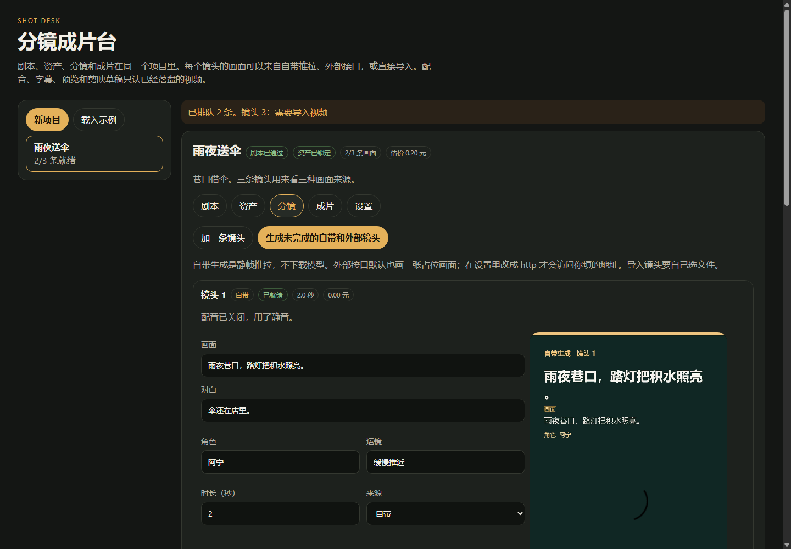

# 分镜成片台

本地的短视频工作台。一个项目里完成剧本、资产、分镜、配音、预览和剪映草稿。每个镜头的画面来源互不影响，时间轴只认已经落在本机的那条视频。

自带生成是一张静帧加缓慢推拉，不下载视频模型。外部接口默认也只在本地画一张占位画面，填了地址才出网。



## 启动

需要 Python 3.11 和 ffmpeg。

```bat
启动.bat
```

或：

```bat
pip install -r requirements.txt
python app.py
```

浏览器打开 `http://127.0.0.1:8775`。关掉窗口就停止。

项目是做什么的、目录怎么分、以后先改哪里，写在 [docs/项目说明.md](docs/项目说明.md)。

## 一条片子怎么走

1. 载入示例，或新建项目后写下剧本。空行分段，段里用 `画面：`、`对白：`、`角色：`、`运镜：`、`时长：`。
2. 保存剧本，拆成镜头，再通过剧本。
3. 补上角色和场景，锁定资产。之后再改资产会取消锁定。
4. 每条镜头选一种来源：
   - 自带：静帧推拉，不下载模型。
   - 外部：默认占位。设置里改成 http 后，按下面的约定提交并轮询。
   - 导入：上传 mp4、mov、mkv、webm 或 avi。保留原声，不另配一遍对白。
5. 每条镜头都有画面后，到成片页合成。页面会标出还缺哪一条。成片、字幕和 `timeline.json` 在 `data/exports/`，也可以直接下载。
6. 设置里可以填剪映草稿目录。本机装着剪映时，点「填入本机剪映目录」再保存。没填也能拿到时间轴包。背景音乐可以上传，也可以去掉。

自带和外部镜头最长 15 秒。更长的素材用导入。

## 外部接口

```
POST {地址}/v1/videos
{"model","prompt","duration_ms","aspect":"9:16"}

GET {地址}/v1/videos/{task_id}
{"status":"queued|running|ready|failed","url","error"}
```

也可以在 POST 里直接返回 `{"status":"ready","url":"..."}`。

## 数据

项目数据库、画面和设置都在 `data/`。密钥写在 `data/settings.json`，页面不回显。

剪映草稿由 pyJianYingDraft 写成明文 `draft_content.json`。剪映 5 和一部分 6 可以直接打开。更高版本如果打不开，用导出目录里的成片和字幕。

## 测试

```bat
python -m unittest tests.test_pipeline
```

## 许可

MIT。
